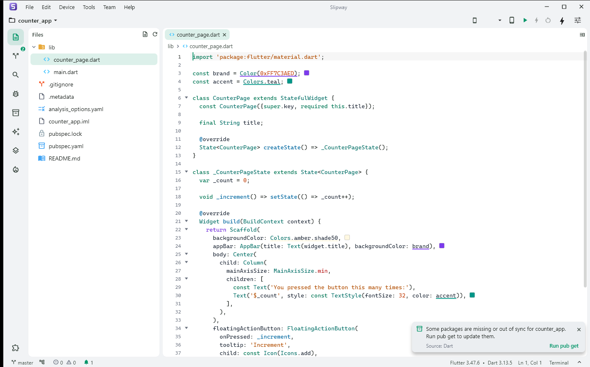

<div align="center">


# Ravo DevKit

**One window for every Android device you test on.**

Find devices, mirror them, read logs, hot reload, and fake printers and payment terminals, all without leaving one window.




</div>

---

## Why you'll love it

Testing POS, Signature, Checkout & friends used to look like this: check the device's IP in Settings, type `adb connect`, open scrcpy, open another terminal for logcat, another for `flutter run`, then find a real printer to test a receipt.

**DevKit does all of that in one window, with nothing else to install:**

- 🔍 **Finds every device on the office network.** USB, Wi-Fi port 5555, and Android 11+ Wireless debugging. No more walking to a desk to check an IP.
- 🖥️ **Mirrors and controls** any device at 60 fps (scrcpy built in), or many devices side by side.
- 🔥 **Flutter run, hot reload, and hot restart** right next to the live screen and logcat.
- 🧾 **Prints receipts without a printer.** The ESC/POS emulator shows the receipt on screen.
- 💳 **Finds PAX terminals** on the network and reads their model and serial.
- 📱 **Manages emulators** like Android Studio's AVD manager, without opening Android Studio.

## ✨ Features

<table>
<tr>
<td width="50%" valign="top">

### 📡 Devices
- Auto-discovery: USB, `adb` Wi-Fi (5555), Wireless debugging via mDNS
- Pair by **QR**, **pairing code** (IP + port), or **connect by IP**, which can switch the phone from its random Wireless-debugging port to 5555 in the same step
- One-click connect / disconnect / copy IP
- **Auto-switch to port 5555** (like `scrcpy --tcpip`): devices on USB or a random Wireless-debugging port move to `ip:5555` by themselves, so they reconnect over Wi-Fi without pairing until reboot. Toggle it in Settings, or use **Enable port 5555** per device
- **Skip pairing**: plug a phone into USB once and tap *Always allow*. Wireless debugging trusts the same key afterwards.
- Shows which of our apps and versions are installed

</td>
<td width="50%" valign="top">

### 🪟 Device workspace
- Opens each device in **its own window**, made for multi-device testing
- Screen mirror: **Fast** (embedded scrcpy) or **Lite** (screenshots), auto-sized to the device's shape with no black bars (drag the divider to override, double-click it to go back to auto)
- Logcat with **crash detection**, files, apps, info
- **Interactive terminal**: `adb shell` on the device, or Git Bash / PowerShell already pointed at it (`ANDROID_SERIAL`)
- **Flutter** run/attach with hot reload/restart, install latest build

</td>
</tr>
<tr>
<td valign="top">

### 📐 Display lab
- Change **resolution, DPI, and screen size** on a real device
- Presets from a 5.5" phone to a **21.5" POS** and **43" 4K signage**
- Shows the resulting **dp size and breakpoint** your layout will hit

</td>
<td valign="top">

### 📱 Emulators
- Start, cold boot, headless, stop, **wipe data**, edit hardware, delete
- Create AVDs from **size presets** (phone, tablet, POS, kiosk, signage)
- **Download system images** directly, with no sdkmanager or Java needed, and search them by API, Android version, or variant

</td>
</tr>
<tr>
<td valign="top">

### 🧾 Printer emulator
- Acts as a network thermal printer on **TCP 9100**, the port our POS apps always use (Backoffice only stores the IP)
- Answers Epson (ePOS2 ASB) and Star (StarIO, status on 9101) status checks, so the POS sees the printer as online
- Renders ESC/POS receipts on 58 / 80 mm paper
- Copy a receipt as an image (paste straight into Jira) or text, or view raw hex

</td>
<td valign="top">

### 💳 Payment terminals
- Scans the subnet for **PAX** terminals (POSLink, port 10009)
- **Identify** reads model, serial, and firmware. It never starts a transaction.

</td>
</tr>
<tr>
<td valign="top">

### 🧹 Maintenance
- **Switch `pos_core` / `pf_processor_plugin` branch** (branch list from Bitbucket) or **use a local clone** via `pubspec_overrides.yaml`, then `pub upgrade` runs automatically
- One-click **update core packages** per project
- Clear the core-package git cache, **pub cache**, **Gradle cache**
- `pub get`, `pub upgrade`, `flutter clean` with live output

</td>
<td valign="top">

### 💬 Team chat (LAN only)
- Finds every DevKit on the office network automatically, with **no internet or server**
- **Everyone** channel plus direct messages, history kept locally
- **Windows notifications**, taskbar flash, and unread badges
- Asks for your name on first launch
- Built-in **🤖 Test bot** to try it on a single PC

### 🧰 And more
- **Terminal**: tabs of Git Bash / PowerShell / cmd opened in any project folder, plus open in VS Code / Explorer / Windows Terminal
- **Store codes**: activation & support codes per store
- **Multi Screen**: many devices in one window, with broadcast input
- **Built-in guide** for USB, Wireless debugging, and the printer
- **Keeps running when closed**: reopen it from the taskbar or tray
- Light & dark theme

</td>
</tr>
</table>

## 🚀 Quick start

**Just want to use it?** Grab the latest build zip from a teammate, unzip it, and run `ravo_devkit.exe`. That's it, because `adb` and `scrcpy` are already inside.

**Building from source:**

```sh
fvm install
fvm flutter pub get
fvm flutter run -d windows
```

Release build (zip the output folder to share):

```sh
fvm flutter build windows --release --no-tree-shake-icons
# → build/windows/x64/runner/Release/
```

> [!IMPORTANT]
> Keep `--no-tree-shake-icons`. Without it, some icons go missing in release builds.

## 🧭 First run

1. **Settings → Project folders**: add the folder where you clone repos. Repos are matched by their Android `applicationId`, so folder names can be anything, up to 3 levels deep.
2. **Devices**: if the orange **Network scan may miss devices** banner appears, click **Fix network access** once.
3. **Devices → Scan network**: phones with Wireless debugging on show up. If one says **Needs pairing**, click the QR icon once. After that it connects automatically.
4. **Printer**: in Backoffice, set the receipt printer IP to this PC's IP and print. The receipt appears in DevKit. The port is fixed at 9100, so there's nothing else to set.

## 🛟 Troubleshooting

| Problem | Try this |
| --- | --- |
| Phone doesn't show up after a scan | Same Wi-Fi as the PC? Wireless debugging on? If Devices shows **Network scan may miss devices**, click **Fix network access** (one admin prompt): it allows DevKit through Windows Firewall and can switch a Public network to Private. |
| Tired of re-pairing Wireless debugging | Once a phone is connected, use its menu → **Enable port 5555** (or the ⟷ button for all). Scans then find it on `ip:5555` until it reboots. |
| "Needs pairing" won't go away | Phone: **Wireless debugging → Pair device with pairing code**, then in DevKit: **Pair device → Pairing code**. |
| `adb` keeps restarting | Another `adb` version is running (Android Studio, an older SDK). DevKit prefers the `adb` on your `PATH`, so keep just one. |
| Core packages stuck on an old commit | **Maintenance → Core packages cache → Clear**, then **Update core**. |
| Teammates don't show up in Chat | Same network? Click **Fix network access** on Devices (Chat uses UDP 47232 + TCP 47231). To test alone, turn on **🤖 Test bot** in Chat: a fake teammate joins and echoes your messages. |
| Need a `pos_core` / plugin fix that isn't merged yet | **Maintenance → click the package chip → Git branch** (or **Local folder** for your own clone). |

## 🗂️ Project layout

```text
lib/
  core/            theme, tools (adb/scrcpy lookup), background/tray, project scanning
  modules/
    devices/       discovery, pairing, workspace window, multi screen
    emulators/     AVD manager, system image downloads
    printer/       ESC/POS parser, TCP server, receipt view
    terminal/      PAX POSLink scanner
    console/       embedded terminals (ConPTY + xterm)
    chat/          LAN chat (UDP discovery, TCP messages, notifications)
    maintenance/   pub/Gradle cache cleanup, core package updates
    stores/        store activation/support codes
    help/          connection guide
    settings/
tool/make_icon.py  regenerates the app icon
windows/third_party/scrcpy/   bundled scrcpy + adb (Apache-2.0)
```

New app? Add it to `knownApps` in `lib/core/apps.dart`, and DevKit will recognise it everywhere.

---

<div align="center">
Made with 💚 for the Ravo team, for testing that's less tedious.
</div>
